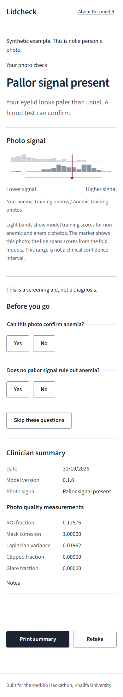
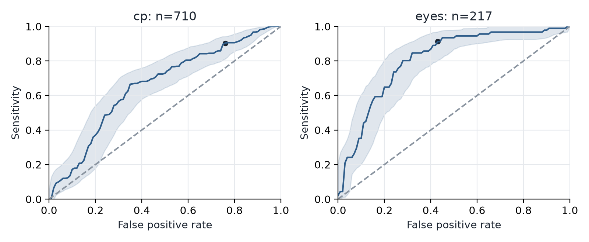
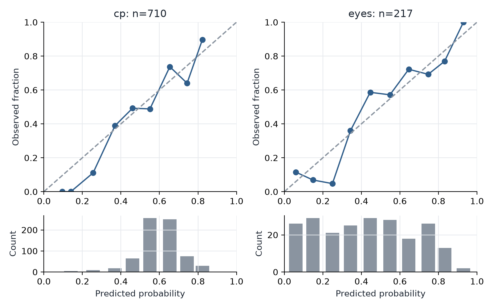
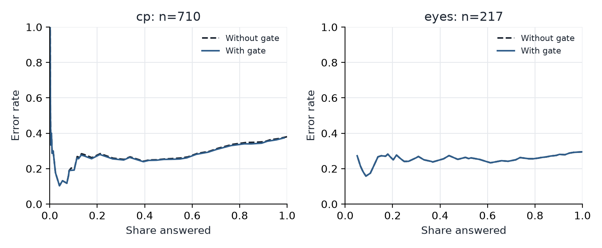
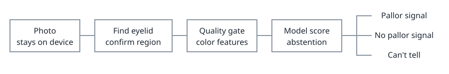

# Lidcheck

Lidcheck checks lower-eyelid photos for a pallor signal, with all photo processing in the browser.

[Open the app](https://youssof20.github.io/lidcheck/) · [CI](https://github.com/youssof20/lidcheck/actions/workflows/ci.yml) · [Pages](https://github.com/youssof20/lidcheck/actions/workflows/pages.yml)



## What this is

This is a screening research prototype, not a clinically validated test. Published phone-photo work uses different populations, acquisition devices and validation procedures, so reported performance is not interchangeable. Wemyss and colleagues' India pregnancy study found poor specificity after transferring an eye-color method to another population ([paper](https://doi.org/10.1088/1361-6579/adab4d)). Lidcheck tests in-photo normalization under simulated lighting and cross-dataset shift, and measures when the app should abstain. Card-free and sclera-referenced methods predate this project.

The project scope is:

1. An open benchmark that compares normalization methods under controlled lighting shifts and across datasets, with patient-level cross-validation and confidence intervals.
2. A quality gate and abstention policy, evaluated with risk-coverage curves.
3. A lighting consistency study on real phone photos from consenting volunteers. It has no hemoglobin labels, so it measures stability, not accuracy.
4. A browser-only app that makes no network requests at run time, enforced by a Content-Security-Policy and tested.

The volunteer study is planned, not completed. Its capture and analysis tooling is included. CP record grouping is a limitation to the patient-level claim, as explained below.

## Results

<!-- results:start -->

Repeated grouped cross-validation. Intervals use patient-cluster bootstrap resampling.

| Dataset / method | Images | AUROC (95% interval) | Specificity at 90% sensitivity |
|---|---:|---:|---:|
| eyes/none | 217 | 0.807 (0.744-0.862) | 0.579 (0.408-0.704) |
| eyes/chromaticity | 217 | 0.799 (0.734-0.852) | 0.563 (0.363-0.672) |
| eyes/gray_world | 217 | 0.829 (0.771-0.882) | 0.698 (0.358-0.764) |
| eyes/white_patch | 217 | 0.813 (0.751-0.866) | 0.579 (0.386-0.727) |
| eyes/sclera | 216 | 0.802 (0.737-0.860) | 0.548 (0.359-0.726) |
| eyes/skin | 14 | not applicable | Not applicable |
| cp/none | 710 | 0.658 (0.592-0.715) | 0.248 (0.130-0.331) |
| cp/chromaticity | 710 | 0.637 (0.568-0.699) | 0.227 (0.118-0.340) |
| cp/gray_world | 710 | 0.643 (0.582-0.700) | 0.248 (0.158-0.349) |
| cp/white_patch | 710 | 0.667 (0.610-0.720) | 0.234 (0.172-0.411) |
| cp/sclera | 0 | not applicable | Not applicable |
| cp/skin | 0 | not applicable | Not applicable |

Adult model: validated-in-prototype. Child model: demo only, not validated.

CP figures are exploratory: grouping is based on image-record keys and duplicate clusters, not independently verified patient identity.
cp: 710 images, 0 missing hemoglobin labels, 212 byte-identical duplicates beyond the first copy, 446 split groups.
eyes: 218 images, 1 missing hemoglobin labels, 0 byte-identical duplicates beyond the first copy, 218 split groups.

Segmentation: mean Dice 0.655, mean IoU 0.502, n=216. The quality gate cannot identify every poor mask.

eyes demographics-only AUROC is 0.840; raw-image AUROC is 0.807. Demographics match or exceed the image model.
cp demographics-only AUROC is 0.614; raw-image AUROC is 0.658. The image model has a higher point estimate; this is not a test of superiority.

Volunteer study: not collected; 0 participants. No stability or H5 result is claimed.



ROC curves show raw-color held-out discrimination with cluster bootstrap bands. The table above contains AUROC intervals and operating-point metrics.



The reliability diagram compares observed labels with mean repeated held-out scores. The histogram shows where scores concentrate.
eyes: Brier 0.177 (0.154-0.203); ECE 0.078 (0.064-0.144).
cp: Brier 0.223 (0.207-0.238); ECE 0.072 (0.040-0.127).



Error rate is plotted against the fraction of photos answered as the abstention band widens. This is a descriptive held-out curve; it does not select the deployed band.

<!-- results:end -->

## How the app decides



The browser converts the photo to linear RGB, finds a candidate conjunctiva region, checks quality and computes color summaries. A calibrated logistic model gives a pallor score; poor quality or uncertainty leads to "can't tell". Confirm the marked eyelid before viewing the result. The scale displays training distributions and a fold-model score range, not a person's probability of having anemia.

## Run it

Install Node.js and uv, then:

```sh
cd web
npm ci
npm run dev
```

For a production preview and browser tests:

```sh
cd web
npm run build
npx playwright install chromium
npm run test:e2e
npm run preview
```

For the research pipeline, place the archives described below and run from the repository root:

```sh
uv sync --locked
uv run lidcheck all
uv run python scripts/check_readme_results.py
uv run pytest
```

`make all` also installs dependencies, runs the research pipeline, synchronizes the README, builds the app and runs all checks. On Windows without Make, use the commands above and the web commands separately. Research runs are longer than CI; CI uses synthetic fixtures and the committed model without datasets. Delete ignored `data/interim/` caches after changing algorithms or archives.

For Pages, set Settings, Pages, Source to GitHub Actions. The production base path defaults to `/lidcheck/`; set `BASE_PATH` when hosting elsewhere. Static assets load once; photo processing does not use the network. The About page displays the bundled manifest without fetching it.

Open `#study` for anonymous measurements. Check with the hackathon committee whether ethics review applies before collecting volunteer photos. Read [capture instructions](docs/capture-protocol.md) and the [consent template](docs/consent-template.md).

## Data

| Dataset | Source | Size | Terms and location |
|---|---|---|---|
| Eyes-defy-anemia | [IEEE DataPort](https://ieee-dataport.org/documents/eyes-defy-anemia) | See generated audit above | Supplied archive requests citations; keep `data/dataset anemia.zip`. |
| CP-AnemiC mirror | [Kaggle](https://www.kaggle.com/datasets/karankumar4090/cp-anemic-dataset-same) | See generated audit above | User reports Apache 2.0; original release removed, provenance unresolved; keep `data/cp-anemic.zip`. |

Data is not redistributed. [Data notes](data/README.md) include checksums, mapping rules, duplicate handling and the citation list from the supplied archive. Patient labels, photos and intermediates are ignored by Git. CP uses its historical class threshold for replication; current WHO child thresholds differ by age ([guideline](https://www.who.int/publications/i/item/9789240088542)).

## Prior work

| Work | Reused idea or difference |
|---|---|
| [Patel, AnemiaVision](https://arxiv.org/abs/2604.22964) | Earlier web application; Lidcheck processes the photo in the browser. |
| [Wemyss et al.](https://doi.org/10.1371/journal.pone.0281736) | Card-free colorimetry already exists; reference methods are benchmarked here. |
| [Mannino et al.](https://doi.org/10.1038/s41467-018-07262-2) | Earlier equipment-free fingernail method; Lidcheck uses eyelids. |
| [Dimauro et al.](https://doi.org/10.1016/j.bspc.2022.104489) | Sclera and vessel color analysis; controlled acquisition differs from phone capture. |
| [Fuentes-Beingolea et al.](https://doi.org/10.3991/ijoe.v21i07.54439) | Earlier conjunctival preprocessing comparison; Lidcheck tests shift and browser parity. |

[Source verification notes](docs/prior-art.md) distinguish verified publications from unverified leads.

## Limitations

Adult and child datasets are different populations. The cohorts are small and the adult photographs use controlled illumination. CP patient linkage and mirror terms remain unverified despite duplicate grouping. Scleral pigmentation can break a white reference, and heuristic masks can include the wrong tissue. Synthetic lighting does not reproduce every phone's image processing. The planned consistency study has no hemoglobin labels. This tool is not clinically validated. See [methods](docs/methods.md), the fixed [protocol](docs/protocol.md) and [limitations](docs/limitations.md).

## Repository layout

```text
configs/       Seeds and image-quality policy
src/lidcheck/  Audit, image processing, evaluation and export
tests/         Synthetic fixtures and Python checks
web/           Browser app and TypeScript/Playwright tests
results/       Generated aggregate tables and figures
docs/          Protocol, methods, consent and source checks
```

## Citation and license

Cite the software and source datasets using [CITATION.cff](CITATION.cff).

Code uses the [MIT license](LICENSE); dataset and font terms are separate.

Built at the 3rd MedBio Hackathon, Khalifa University, November 2026.
